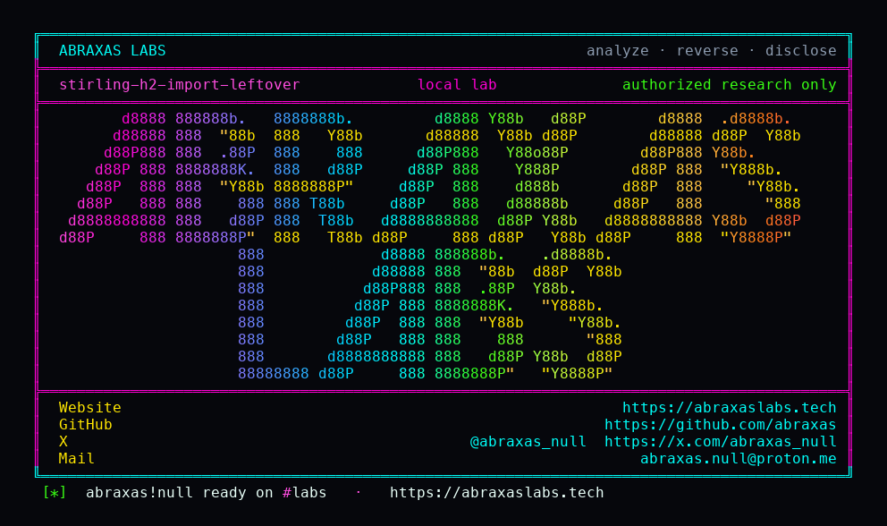

<p align="center">
  
</p>

<p align="center">
  <a href="https://abraxaslabs.tech"><strong>abraxaslabs.tech</strong></a>
  &nbsp;·&nbsp;
  <a href="https://github.com/abraxas">github.com/abraxas</a>
  &nbsp;·&nbsp;
  <a href="https://x.com/abraxas_null">@abraxas_null</a>
  &nbsp;·&nbsp;
  <a href="mailto:abraxas.null@proton.me">abraxas.null@proton.me</a>
  &nbsp;·&nbsp;
  <a href="https://github.com/abraxas/stirling-h2-import-leftover">stirling-h2-import-leftover</a>
</p>

# stirling-h2-import-leftover

**Stirling-PDF** `3.2.0` - Stirling Tools

**Class:** H2 RUNSCRIPT leftover of GHSA-mrr8. **Reach:** Remote ROLE_ADMIN.

[`POST /api/v1/database/import-database`](https://github.com/Stirling-Tools/Stirling-PDF/blob/v3.2.0/app/proprietary/src/main/java/stirling/software/proprietary/security/controller/api/DatabaseController.java) is `@PreAuthorize("hasRole('ADMIN')")`. `validateSqlContent` is supposed to stop `CREATE ALIAS`. The denylist is `CREATE\s+(FORCE\s+)?ALIAS`. H2 `parseCreate` allows `OR REPLACE` before `ALIAS`, so `CREATE OR REPLACE ALIAS … FOR "java.lang.…"` matches the allowlist `\bCREATE\b` and misses the denylist. The validator sanitizes a copy. `verifyBackup` and production `RUNSCRIPT FROM ?` the original file.

[GHSA-mrr8-934j-4g8m](https://github.com/Stirling-Tools/Stirling-PDF/security/advisories/GHSA-mrr8-934j-4g8m) / CVE-2026-85714 closed the original `FILE_READ` / `CREATE ALIAS` / `CSVWRITE` strings. This leftover is the `OR REPLACE` gap on that same validator.

**A ROLE_ADMIN import creates a Java alias the denylist is supposed to stop. A later backup download contains attacker SQL.** Host `FILE_READ` / FileUtils RCE from the original advisory is inferred, not lab-proven in this pack.

| | |
|---|---|
| ID | no CVE yet |
| CWE | [CWE-94](https://cwe.mitre.org/data/definitions/94.html) / [CWE-184](https://cwe.mitre.org/data/definitions/184.html) |
| CVSS | **9.1** `CVSS:3.1/AV:N/AC:L/PR:H/UI:N/S:C/C:H/I:H/A:H` |
| Product | [Stirling-PDF](https://github.com/Stirling-Tools/Stirling-PDF) |
| Affected | **v3.2.0** (`a7e593728dd9aa81e75318a949789d3c2e9ee754`), image `stirlingtools/stirling-pdf:3.2.0-fat` |
| Auth | ROLE_ADMIN, default embedded H2. Default first admin `admin` / `stirling` until changed |
| License | [GNU Affero GPL v3.0](LICENSE) |
| Lab | `127.0.0.1:18152` only |

Leftover of the [Stirling-PDF v3.2.0 leftovers](https://abraxaslabs.tech/research/stirling-pdf-3.2.0-leftovers) series. Sibling: [stirling-storage-folder-idor](https://github.com/abraxas/stirling-storage-folder-idor) (processing-folder implied storage root). This pack is the H2 import leftover.

## What an attacker can do

ROLE_ADMIN on login-on proprietary/fat with the default embedded H2. Default first admin is `admin` / `stirling` when `initialLogin` is empty. They do not need unauth. Lite image and PostgreSQL datasources do not ship this controller.

Privilege table (exhaustive). Same bar as [Signal-Server Dropwizard admin](https://abraxaslabs.tech/research/signal-server-dropwizard-admin): method + path, what that call grants, recon vs integrity vs availability, lab-proven vs inferred, adjacent surface that stays closed.

| Axis | Method + path | Grants | Provenance |
|---|---|---|---|
| Integrity | ROLE_ADMIN `POST /api/v1/database/import-database` with `CREATE OR REPLACE ALIAS lab_nano FOR "java.lang.System.nanoTime"` plus `INSERT INTO lab_w VALUES('STIRLING-H2-IMPORT-WITNESS')` | 200 `importIntoDatabaseSuccessed`. Java alias created. Attacker SQL committed under `RUNSCRIPT` | **Lab-proven** |
| Recon | ROLE_ADMIN `GET /api/v1/database/createDatabaseBackup` then `GET /api/v1/database/download/backup_202610172328.sql` | 50432-byte backup contains `STIRLING-H2-IMPORT-WITNESS` | **Lab-proven** |
| Recon / host file | same import wrapping `FILE_READ('/etc/os-release')` in `EXECUTE IMMEDIATE` | 500 `Backup verification failed`. Host bytes not in a backup | Lab extra FAIL |
| Integrity / RCE | alias `org.h2.store.fs.FileUtils` plus `CSVWRITE` of a Python user-site `.pth`, then office convert | Command execution as the service account | Inferred from GHSA-mrr8. Not labbed here |
| Availability | none claimed | Import can replace application tables | Inferred. Not the lab oracle |

**Stays closed on this pin**

| Axis | Method + path | Why it is closed |
|---|---|---|
| Integrity | unauth `POST /api/v1/database/import-database` | 401 `Authentication required`. Method security ADMIN stays on when HTTP is `permitAll` |
| Integrity | ROLE_ADMIN import of bare `CREATE ALIAS` | 500 `SQL script contains disallowed operations and was rejected` |
| Integrity | lite / `DISABLE_ADDITIONAL_FEATURES` image | `DatabaseController` absent |
| Integrity | custom PostgreSQL datasource | `@Conditional(H2SQLCondition.class)` |

I am not claiming a reverse shell, and I am not claiming host `FILE_READ` as lab-proven. The leftover is the denylist miss that lets `CREATE OR REPLACE ALIAS … FOR "java.lang.…"` through RUNSCRIPT.

## How I found it

v3.2.0 still ships the GHSA-mrr8 validator. I sat on that tag and read `DENIED_PATTERNS`. The alias line is `CREATE\s+(FORCE\s+)?ALIAS`. H2's parser accepts `CREATE OR REPLACE ALIAS`. Tests cover the obvious `CREATE ALIAS` / `FILE_READ(` strings. They do not cover `OR REPLACE`.

The lab logs in as default admin, finishes `change-password-on-login`, imports a denied `CREATE ALIAS` (500), then imports `CREATE OR REPLACE ALIAS` plus an INSERT witness (200). A backup download contains the witness.

Wrong turns: treating unauth import as in-scope (401); treating `EXECUTE IMMEDIATE` + `FILE_READ` as the leftover (verifyBackup 500); treating the original un-obfuscated `CREATE ALIAS` as still live (it is denied).

## Lab

```bash
python3 stirling-h2-import-leftover-Abraxas-Labs.py
```

or

```bash
cd lab
./run.sh
```

Target **only** `http://127.0.0.1:18152`. Image `stirlingtools/stirling-pdf:3.2.0-fat`. Docker required. Login-on. The launcher `chdir`s into `lab/` and execs `run.sh`.

```text
IOC unauth-import http=401
IOC negative-import http=500 ... disallowed operations ...
IOC leftover-import bypass=create-or-replace-alias http=200 ... importIntoDatabaseSuccessed
IOC download file=backup_202610172328.sql http=200 bytes=50432 witness=1
SUCCESS stirling-h2-import-leftover negative-denied=yes bypass=create-or-replace-alias backup-has-witness=yes file=backup_202610172328.sql unauth-import=401 STIRLING-H2-IMPORT-WITNESS
```

## The fix

Extend the denylist so `OR REPLACE` cannot sit between `CREATE` and `ALIAS`. Run `validateSqlContent` on the same bytes `RUNSCRIPT` will execute. Deny `EXECUTE IMMEDIATE` unless the inner SQL is also scanned.

```java
Pattern.compile("(?i)\\bCREATE\\s+(OR\\s+REPLACE\\s+)?(FORCE\\s+)?ALIAS\\b")
```

Re-run the [loopback client](https://github.com/abraxas/stirling-h2-import-leftover/blob/main/stirling-h2-import-leftover-Abraxas-Labs.py) against a patched build: leftover import must 400/500 the way bare `CREATE ALIAS` already does.

Until then, do not treat "I banned `CREATE ALIAS`" as "I banned H2 Java aliases."

## References

- [github.com/Stirling-Tools/Stirling-PDF](https://github.com/Stirling-Tools/Stirling-PDF) tag [v3.2.0](https://github.com/Stirling-Tools/Stirling-PDF/releases/tag/v3.2.0) (`a7e593728dd9aa81e75318a949789d3c2e9ee754`)
- [GHSA-mrr8-934j-4g8m](https://github.com/Stirling-Tools/Stirling-PDF/security/advisories/GHSA-mrr8-934j-4g8m) / CVE-2026-85714
- [abraxaslabs.tech/research/stirling-h2-import-leftover](https://abraxaslabs.tech/research/stirling-h2-import-leftover)
- [abraxaslabs.tech/research/stirling-pdf-3.2.0-leftovers](https://abraxaslabs.tech/research/stirling-pdf-3.2.0-leftovers)

Vendor intake: GitHub Security Advisory tab or [security@stirlingpdf.com](mailto:security@stirlingpdf.com). I am not opening a public issue on Stirling-Tools/Stirling-PDF.

Abraxas Labs
https://abraxaslabs.tech
https://github.com/abraxas
abraxas.null@proton.me
